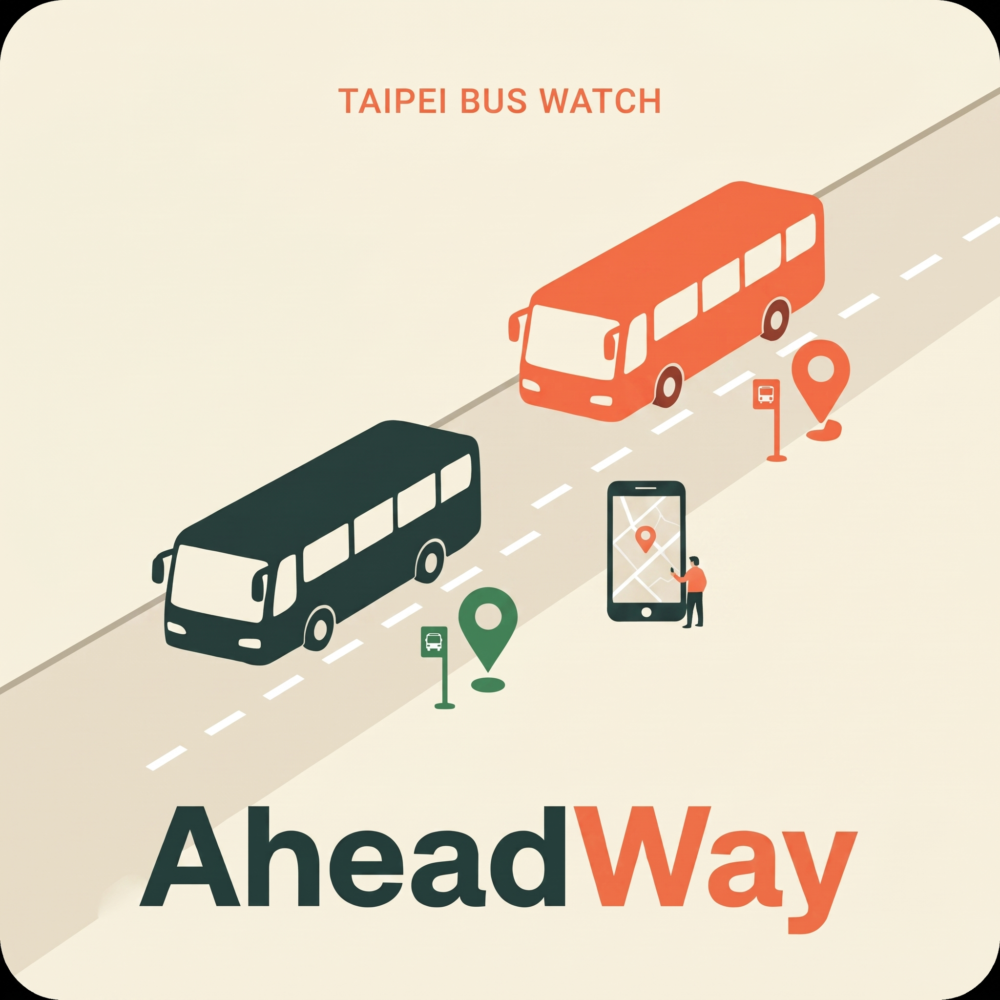
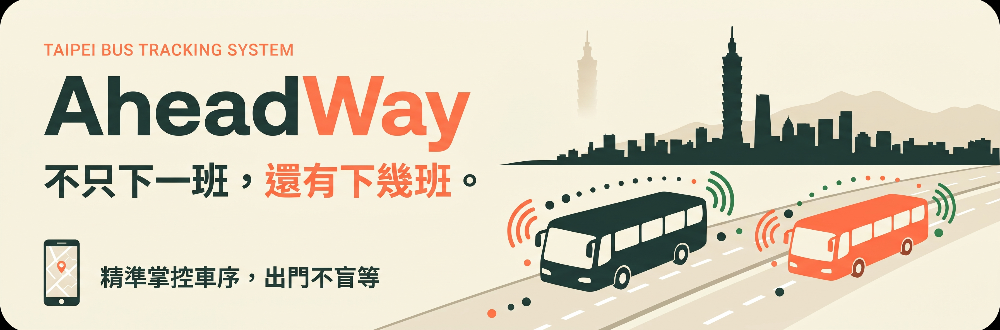
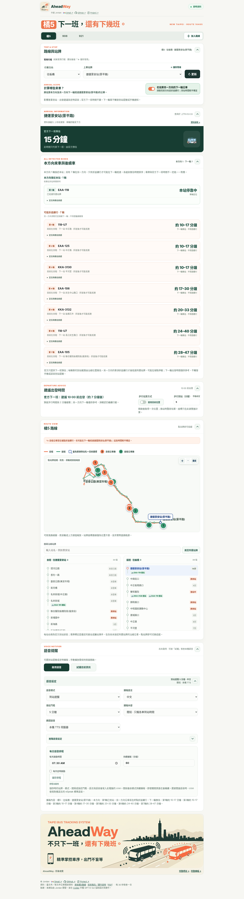
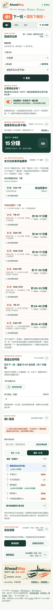

<div align="center">
  
  <h1>AheadWay</h1>
  <p><strong>下一班，還有下幾班。</strong><br />Live Taipei and New Taipei bus arrivals, with the next buses made visible.</p>
  <p>
    <a href="bus_tracker/static/technical-report.md">Technical report</a> ·
    <a href="https://pda5284.gov.taipei/MQS/routelist.jsp">Official Taipei bus routes</a>
  </p>
</div>

<p align="center"><strong>Language:</strong> <a href="README.md">English</a> · <a href="README_zh-TW.md">繁體中文</a></p>

<p align="center">
  
</p>

## The problem

Most bus boards answer one question: **when is the next bus?** That leaves riders guessing whether another bus is close behind, whether the displayed time is fresh, and when they should leave to reach the stop.

AheadWay is a responsive bus-tracking dashboard for Taipei and New Taipei. It combines the official next-bus status with estimates for other identifiable buses approaching a chosen stop, then puts the route, stop, freshness, and departure advice in one place.

## Dashboard preview

The screenshots below were captured with Playwright from the running local dashboard. The capture was just after midnight, so the live status correctly showed no active service; the route map and mobile layout remain visible.

<details open>
  <summary>Desktop dashboard</summary>
  <p align="center"></p>
</details>

<details>
  <summary>Mobile dashboard</summary>
  <p align="center"></p>
</details>

## What it does

- **Shows more than the next bus.** The official next-arrival estimate stays distinct from individually tracked later buses. Per-bus estimates use recent vehicle locations, stop events, and travel time between stops, and show an uncertainty range and data age.
- **Handles route shape and direction.** Switch routes and directions, select a stop, and optionally include buses that may finish the opposite leg, turn around, and continue to the selected stop. Those next-circuit estimates are clearly conditional.
- **Makes the route inspectable.** Browse stop-by-stop official status and recent bus events, search for a stop, jump to the selected stop, and inspect a zoomable route sketch with direction-colored bus counts.
- **Helps plan when to leave.** Combine bus arrivals with a manually entered walk time or a rough browser-location estimate, including a configurable two-minute buffer.
- **Speaks the live board.** Use Chinese or English voice alerts and periodic briefings through browser speech, eSpeak, or a local OpenAI-compatible TTS server. The owner dashboard can schedule daily voice reports.
- **Supports phone reminders.** On a supported HTTPS deployment, Web Push can send a text departure notification after the page closes. It does not provide background voice playback.
- **Lets riders add routes.** Start with 橘5, 908, and 921, then search for a route or paste an official Taipei route link. Added route tabs and preferences are stored in that browser.

## Why use it

Use AheadWay when a single next-bus number is not enough to make a travel decision. It makes the distinction between **official information** and **system estimates** explicit, shows when data was fetched, and gives riders a way to see the vehicles behind the first arrival. The route view helps answer “where is the bus along this route?”, while walk-time advice helps answer “when should I head out?”.

The interface is designed for a quick stop check on a phone, while keeping the route detail and voice controls available on desktop. No account is needed for the local dashboard.

## Quick start

Requires Python 3.10 or newer and internet access to the public Taipei/New Taipei bus feeds.

```bash
git clone <your-repository-url>
cd <repository-directory>
python3 -m bus_tracker.server 8000
```

Open <http://127.0.0.1:8000>. Select a route, direction, and stop. The app refreshes the live board automatically; selecting a different stop requests fresh data immediately.

Optional features have additional requirements:

- Install **eSpeak NG** for server-generated speech when browser speech is unavailable.
- Run a compatible local TTS server if you want to use the OpenAI-compatible audio endpoint.
- Configure the included owner/public services and Tailscale Funnel for remote HTTPS access and phone Web Push. Keep owner-only schedule controls private.

See the [technical report](bus_tracker/static/technical-report.md) for full setup, Tailscale Funnel deployment, API/data sources, estimation details, voice configuration, notifications, and known limitations.

## Data and limits

The app reads public route, stop, vehicle, stop-event, and official estimated-time feeds from Taipei and New Taipei. It does not scrape the route webpage to invent live positions. The official feed provides a next-bus estimate, not an ETA for every following vehicle; later arrival times are estimates based on vehicles that can be identified from fresh feed data.

Bus positions and upstream feeds can be delayed. A bus without a fresh location or stop event may not appear. Closed routes, terminal turns, traffic, and GPS quality can affect estimates. The route drawing connects stop coordinates and is not a road-navigation map. Location-based walking time is a rough estimate, not turn-by-turn directions. Always use the displayed data age and uncertainty as context.

The optional Hugging Face [`speech-to-speech`](https://github.com/huggingface/speech-to-speech) project is **not** the live voice pipeline in this app. AheadWay currently speaks dashboard information using browser speech, eSpeak, or the configured local TTS server; full speech-to-speech conversation remains a possible future integration.

## Project map

| Path | Purpose |
| --- | --- |
| `bus_tracker/static/` | Dashboard, responsive styles, browser logic, logo, banner, and technical report |
| `bus_tracker/server.py` | Local owner dashboard, public viewer, and JSON endpoints |
| `bus_tracker/tracker.py` | Feed cache, route tracking, and per-vehicle arrival estimates |
| `bus_tracker/feeds.py`, `catalog.py` | Municipal feeds and route search |
| `bus_tracker/speech_audio.py`, `schedule.py`, `scheduled_voice.py` | Speech synthesis and owner voice scheduling |
| `bus_tracker/push.py`, `bus_tracker/static/sw.js` | Optional phone Web Push notifications |
| `deploy/` | Example user services for owner and public server processes |
| `docs/` | Playwright screenshots of the dashboard |

## Credits

Built by Jordan, with design and implementation assistance from GPT-6-Sol in [Codex](https://openai.com/codex/). Data is provided by Taipei and New Taipei public bus information feeds. See the [technical report](bus_tracker/static/technical-report.md) for source references and implementation notes.
