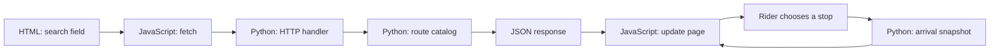

# Learn web development with AheadWay

**A beginner's guide to Python, JavaScript, HTML, CSS, and UI/UX design**

AheadWay is a small bus tracker for Taipei and New Taipei. A rider searches for a route, chooses a direction and boarding stop, and sees the official next arrival alongside estimates for other detected buses. This guide uses that real journey to explain how a web application works.

You do **not** need to understand the whole project before starting. Read the sections in order, run the examples, and return to the source files as you learn. The [technical report](../bus_tracker/static/technical-report.md) covers the bus data and advanced features in more depth.

## What you will learn

| Topic | Question to answer | Main file |
| --- | --- | --- |
| Python | How does the server search routes and prepare arrival data? | [`catalog.py`](../bus_tracker/catalog.py), [`server.py`](../bus_tracker/server.py) |
| HTML | What elements and labels make up the page? | [`index.html`](../bus_tracker/static/index.html) |
| CSS | How do the same elements work on a phone and desktop? | [`style.css`](../bus_tracker/static/style.css) |
| JavaScript | How do clicks, API requests, and new data change the page? | [`app.js`](../bus_tracker/static/app.js) |
| UI/UX | How do we help a rider make a decision without hiding uncertainty? | All four files |

Python 3.10 or newer and a browser are enough for the basic app. Node.js is optional for the JavaScript regression test. The core page uses native browser features and Python's standard library; there is no React build step. Live arrivals need access to the municipal feeds, so your numbers will differ from the examples below.

## 1. Run a learning copy locally

From the repository root, start a development server on a free port. `8002` avoids the project's usual owner port `8000` if it is already running:

```bash
python3 -m bus_tracker.server 8002
```

Open <http://127.0.0.1:8002/>. The first visit shows an empty route list. Search for `Orange 5` or `橘5`, add the route, choose a direction, then **choose a stop**. AheadWay waits for that stop choice before requesting arrivals for it. Browser preferences on port `8002` are separate from those on port `8000` or a public HTTPS address because browser storage belongs to an origin.

Keep the terminal open while browsing. Stop this development server with `Ctrl+C`. If the port is busy, choose another number. To inspect a change, reload the page; static files are served directly. Use your browser's Developer Tools (`F12`) to view the **Elements**, **Network**, and **Console** panels.

> **Work on this local server.** The owner server exposes controls that the public viewer does not. The [technical report](../bus_tracker/static/technical-report.md) explains deployment and the public mode. This tutorial does not require publishing a server or setting up voice, push notifications, or Google Maps.

## 2. Follow one route search through the whole app

This is the central idea of a client/server application:



1. The route search field exists in `index.html` as `<input id="route-query">`. Its `id` lets JavaScript find it.
2. `searchRouteCatalog()` in `app.js` reads the entered text and requests `api/catalog?q=Orange%205`. `%20` is the URL form of a space; `encodeURIComponent(query)` produces it.
3. `Handler.do_GET()` in `server.py` recognizes `/api/catalog` and calls `search_routes(query)` in `catalog.py`.
4. The catalog checks official route data. It normalizes common spellings, so `橘5`, `Orange 5`, and `Orange Five` find the same route.
5. The server sends JSON. JavaScript builds buttons from the results. Clicking one adds a route tab and asks for its stops through `/api/stops`.
6. Once a rider selects a stop, JavaScript requests `/api/arrivals`. `FeedCache.snapshot()` and `build_snapshot()` in [`tracker.py`](../bus_tracker/tracker.py) prepare the official status and detected vehicles. The page renders them in separate sections.

Try the catalog request directly in your browser: <http://127.0.0.1:8002/api/catalog?q=Orange%205>. A **shortened illustration** of one result is:

```json
[
  {
    "id": 16405,
    "name": "橘5",
    "nameEn": "Orange Five",
    "heads": ["往捷運景安站", "往板橋"]
  }
]
```

The real response includes more fields, such as the data source and official link. JSON is a text format for arrays (`[...]`), objects (`{...}`), strings, numbers, booleans, and `null`. In this example, `id` is a number; `heads` is an array of two direction labels.

**Try it:** In Developer Tools → Network, search for a route again. Find the `catalog` request, then inspect its URL, status code, and response. Next choose a stop and find the `stops` and `arrivals` requests. If live data is unavailable, the page should show an error or unavailable state; that is a useful state to study too.

## 3. Python: turn data into useful answers

Python runs on the **server**, outside the browser. Start with [`catalog.py`](../bus_tracker/catalog.py):

```python
def route_payload(route_id):
    info = route_info(route_id)
    return {"id": route_id, "name": info["name"], "nameEn": info["name_en"]}
```

This is a **shortened teaching version** of the real function. `def` defines a function. `route_id` is its input. `info` is a dictionary: `info["name"]` gets the Chinese route name. The returned dictionary can become a JSON object in an HTTP response. The real function also returns directions, source, and other route details.

The official feed stores 橘5's English name as `Orange Five`. A rider may type `Orange 5`. The real `search_key()` function uses Unicode normalization, lowercasing, and common number words to make those spellings comparable. Run this **offline** example from the repository root:

```bash
python3 - <<'PY'
from bus_tracker.catalog import search_key

for name in ("橘5", "Orange 5", "Orange Five", "Ｏｒａｎｇｅ ５"):
    print(name, "->", search_key(name))
PY
```

Each line should end with `orange5`. This small function is easy to check without asking the live bus feed for data. `search_routes()` does more: it searches known route records, ranks exact names first, and returns matching payloads. Its tests in [`test_catalog.py`](../bus_tracker/test_catalog.py) check aliases and verify that `Orange 5` does not accidentally mean `Orange 50`.

Python also acts as the HTTP server. In [`server.py`](../bus_tracker/server.py), `Handler.do_GET()` looks at the URL path and calls the appropriate function. For example, `/api/stops` reads `route_id`, validates that the route exists, and responds with stop dictionaries. A bad route or missing value produces an error response instead of a usable stop list.

### Why the arrival code is more involved

The official feed's next arrival and AheadWay's estimates for **later detected vehicles** are different kinds of information. `tracker.py` reads route, stop, position, event, and official ETA feeds. It orders stops, locates recent vehicles, estimates travel time across the remaining stops, and returns a snapshot. For a loop or turnaround, a bus on the opposite leg is only a **possible** next-circuit arrival: it may stop service at the terminal.

A snapshot has fields such as `officialEtaSeconds`, `officialStatus`, `vehicles`, and `updatedAt`. If the official ETA is unavailable, that does **not** prove that the route has no buses. This is why the UI shows status, data age, and estimated vehicles separately. Read the [technical report](../bus_tracker/static/technical-report.md) when you are ready for the calculation itself.

**Python exercise:** Predict the output of `search_key("Red 2")` before running it. Then locate the test for `Orange 5` in `test_catalog.py`. What would go wrong if route search used only `query in route_name`?

## 4. HTML: give the page meaning

HTML describes **what** an element is. Here is a small version of the stop selector in [`index.html`](../bus_tracker/static/index.html):

```html
<label for="stop">上車站牌</label>
<select id="stop">
  <option value="">請選擇上車站牌</option>
</select>
```

`<label>` tells people what the field means; `for="stop"` connects it to `id="stop"`. `<select>` is a built-in dropdown, and each `<option>` is a choice. In AheadWay, JavaScript replaces the initial options with selectable stops returned by the API. The empty `value` means no real stop is selected yet.

The page also uses `<details>` and `<summary>` for expandable cards:

```html
<details class="selection-card" open>
  <summary>Route &amp; stop</summary>
  <p>Choose your direction and boarding stop.</p>
</details>
```

This is a **standalone illustration** of the real Trip & Stop card, which contains more controls. `open` means expanded initially. `<summary>` supplies a keyboard-operable disclosure control without writing custom toggle code. The ampersand is written as `&amp;` in HTML.

Look in the real file for `<main>`, `<header>`, `<section>`, `<button>`, and the arrival status element with `role="status"`. These tags and attributes help screen readers and browsers understand the page. A visible control should have a clear name: the route's `+` button has an `aria-label`, so its purpose is still clear when only the symbol fits on a phone.

**HTML exercise:** In Developer Tools → Elements, inspect the boarding-stop label and dropdown. Change the label text temporarily in Developer Tools. The change disappears on reload because you changed the browser's in-memory page, not the source file. This is a safe way to experiment.

## 5. CSS: make the structure readable on every screen

CSS describes **how** HTML looks. A rule has a selector and declarations:

```css
.route-stop-name {
  min-width: 0;
  overflow-wrap: anywhere;
}
```

The selector `.route-stop-name` finds elements with that class. `overflow-wrap: anywhere` allows a long English stop name to wrap instead of running outside a narrow route column. The latest Route View uses this rule and also measures map labels so they fit in Chinese and English.

The project gives recurring colors a role with CSS variables. A simplified example is:

```css
:root {
  --ui-ink: #173d32;
  --ui-soft: #f3f8f4;
}

.example-button {
  color: var(--ui-ink);
  background: var(--ui-soft);
}
```

Real buttons use the project's existing selectors, but the principle is the same: one token represents a consistent role. Do not choose a random green each time you add a control. Route direction colors and warning colors have different meanings and should remain distinct.

A **media query** changes layout when space is limited:

```css
@media (max-width: 650px) {
  .route-columns {
    grid-template-columns: 1fr;
  }
}
```

Above that width, the two direction columns can sit side by side. At or below `650px`, they form one column. The real phone UI also puts the stop list before the optional map detail. Resize Developer Tools' device view to `390px` and `360px`; check that the page has no horizontal scrolling and that a long English stop name remains readable.

**Why did my CSS change do nothing?** `style.css` has several rules for some of the same elements. The browser's cascade considers selector specificity and source order; a later rule of equal specificity can override an earlier one. Use the **Styles** and **Computed** panels to see which declaration won before adding another override.

**CSS exercise:** In Developer Tools, temporarily change `--ui-soft` to a slightly different pale green. Inspect a secondary control and its contrast with the text. Reload to undo the experiment. Explain whether the color still reads as a secondary action rather than a warning or an arrival status.

## 6. JavaScript: react to a rider and update the DOM

JavaScript runs in the **browser**. It reads input, calls the API, saves browser preferences, and updates the Document Object Model (DOM), the browser's tree of HTML elements.

This `request()` helper is from [`app.js`](../bus_tracker/static/app.js):

```javascript
async function request(url, options = {}) {
  const response = await fetch(url, {cache: 'no-store', ...options});
  const data = await response.json();
  if (!response.ok) throw new Error(data.error || '資料無法取得');
  return data;
}
```

`async` means the function can wait for an operation. `await fetch(...)` pauses **that function** until an HTTP response arrives; it does not freeze the entire browser. `response.json()` parses JSON into JavaScript objects and arrays. `response.ok` distinguishes success from a 4xx/5xx HTTP error. The caller uses `try`/`catch` to show a useful error message.

An event listener runs after a user action. The real stop-change handler is compact:

```javascript
stopEl.addEventListener('change', () => {
  syncStopSelection(true);
  renderSelectionSummary();
  renderScope();
  update({selected: true, fresh: true});
});
```

`stopEl` refers to `<select id="stop">`. When its value changes, the app updates the selected-trip summary, recalculates which buses are in scope, and requests fresh arrivals. `update()` also prevents an older response for a previous stop from replacing the currently selected stop's display. Apart from user actions, the page checks for updates every 30 seconds.

The app creates result buttons with `document.createElement(...)` and sets names with `textContent`. That is safer than inserting an external stop or route name as HTML. `localStorage` remembers added route IDs, selected stops, saved trips, and UI language **in this browser**; it is not a shared account or a server database.

You can try browser storage in the Console without touching AheadWay's own keys:

```javascript
localStorage.setItem('aheadway-learning-example', '16405');
localStorage.getItem('aheadway-learning-example'); // '16405'
localStorage.removeItem('aheadway-learning-example');
```

Storage values are strings, even when they look like numbers. The actual app uses names such as `bus-tracker-added-routes` and stores a JSON array of route IDs there.

Try a pure JavaScript calculation in Developer Tools → Console:

```javascript
function wholeMinutes(seconds) {
  return Math.ceil(seconds / 60);
}

wholeMinutes(125); // 3
```

`Math.ceil` rounds up. This example teaches functions and numbers; it is **not** AheadWay's bus ETA algorithm. The actual later-bus estimate uses remaining stops and observed travel data on the server.

**JavaScript exercise:** Open the Console and run `document.querySelector('#stop').value`. Before selecting a stop it should be empty; afterward it should be a stop ID string. Why does `Number(directionEl.value)` appear in the app even though direction options contain `0` and `1`? (Hint: values read from HTML controls are strings.)

## 7. UI/UX: help someone catch a bus

**UI** is what the rider sees and touches. **UX** is the experience of using it to make a decision. For a bus tracker, a polished card is less useful if it hides whether the time is official, estimated, or stale.

AheadWay makes several deliberate choices:

| Rider's question | Design response | Failure it prevents |
| --- | --- | --- |
| “Which stop am I tracking?” | Show route, direction, and stop together; require a stop choice for a new route. | Showing arrivals for an arbitrary first stop. |
| “Is this number official?” | Put the official next arrival in its own card; label later vehicles as estimates. | Giving inferred ETAs the authority of the official feed. |
| “Could another bus come after this one?” | List detected buses with next stop, estimate range, and data age. | Treating a single next-bus number as the whole service. |
| “Should I leave now?” | Combine arrival with walking time and a two-minute buffer; warn when the margin has passed. | Saying “leave now” next to a time already in the past. |
| “Why might a bus disappear?” | Show unavailable/stale states and label possible turnaround buses as conditional. | Interpreting missing data or a terminal turn as certainty. |
| “How do I use this on my phone?” | Keep arrivals near the top; put long controls and the map behind clear disclosures. | Making riders scroll through settings before seeing arrivals. |

The [technical report](../bus_tracker/static/technical-report.md) documents the color roles. Deep green is a primary action or key information; orange and green distinguish route directions; blue identifies a selected stop; warning colors signal stale or risky states. Text labels remain essential because color alone is not enough to communicate meaning.

### A five-minute usability check

Ask someone unfamiliar with the app to complete these tasks without explanation:

1. Add a route using `Orange 5`.
2. Identify the direction and select the intended boarding stop.
3. Point to the **official** next arrival and to a **later estimated** vehicle.
4. Explain whether the departure advice is still actionable.
5. Switch the interface to English and find the same stop in Route View.

Watch where they hesitate. Write down the **action they expected**, **what actually happened**, and **one small change** you could test. Check the same tasks on a `390px` phone viewport, with keyboard navigation, and when a feed is slow or unavailable. A good empty/error state says what happened and what the rider can do next.

## 8. Localization: UI language is part of design

The source UI text is Traditional Chinese in `index.html` and `app.js`. [`i18n.js`](../bus_tracker/static/i18n.js) contains a language table with English `exact` phrases and patterns for messages containing numbers or times. The top-right **中 / EN** controls switch the interface; the spoken voice language is a separate setting.

A small language-table entry looks like this:

```javascript
const example = {
  '選擇站牌': 'Choose a stop',
  '上車站牌': 'Boarding stop'
};
```

This is an illustration of entries in the real `en.exact` table. For route and stop names, the app prefers the official `nameEn` or `headsEn` when available. The Route View measures the **displayed** name before drawing a map label, because the English version can be much longer than the Chinese one. Dynamic text may need a template or pattern; replacing isolated words can produce unnatural order in another language.

**Localization exercise:** Switch between 中 and EN while Route View is open. Check a long stop name in the list, map badge, and legend. If you change any Chinese UI sentence in source, find its English entry in `i18n.js` and update it too. Check both languages again after the change.

## 9. Practice safely and check your work

Use a separate local port, make one small change at a time, and inspect the result in a browser. The following checks run from the repository root:

```bash
python3 -m unittest discover -s bus_tracker -t .
node --check bus_tracker/static/app.js
node bus_tracker/test_voice.js
git diff --check
git diff
```

The Python suite tests search, arrival logic, server behavior, and more. `test_voice.js` is a JavaScript regression script; Node.js is only needed if you run it. `git diff` shows what you changed, and `git diff --check` catches whitespace errors. A passing test cannot prove that a layout looks good, so also inspect desktop and phone widths in the browser.

Try these in order:

1. **Observe, no edits:** Find the `catalog` JSON response in Network. Identify the route ID, Chinese name, and English name.
2. **Python:** Add a case to `test_catalog.py` for another spelling you expect `search_key()` to normalize. Run the Python suite. If it fails, decide whether the test or normalization needs to change.
3. **HTML and CSS:** Temporarily change a card heading in Developer Tools and inspect its computed font size and color. Find the matching source element and selector. Keep any permanent source change small.
4. **JavaScript:** Use the Console to read `#direction` and `#stop` values. Change a stop and observe the new `/api/arrivals` request in Network.
5. **UI/UX:** Compare the first-time empty state, a loaded stop, and an unavailable-feed state. For each, write one sentence describing what the rider should do next. If the interface does not make that action clear, propose a shorter label or more visible control.

### Answers to the quick checks

- `search_key("Red 2")` produces `red2`. A plain substring search would miss `Orange 5` when the feed says `Orange Five`, and careless prefix matching could confuse `Orange 5` with `Orange 50`.
- `document.querySelector('#stop').value` is a string because HTML form control values are strings. `Number(directionEl.value)` converts `"0"` or `"1"` before comparing it with numeric direction values from the API.
- A route name or ETA inserted with `textContent` is treated as text. Using HTML parsing for untrusted feed text would create an unnecessary injection risk.

### When something does not work

| Symptom | First check |
| --- | --- |
| The page will not open | Is the Python terminal still running? Did you use the same port in the command and browser URL? |
| Route search or arrivals fail | Check the Network response and server terminal. The public feeds or your network may be temporarily unavailable. |
| A source edit is invisible | Reload the local page, then inspect the loaded file and the CSS **Computed** panel. |
| A click does nothing | Check the Console for a JavaScript error and confirm the element ID still matches `app.js`. |
| English text looks wrong | Check the matching entry or dynamic pattern in `i18n.js`, and whether the route feed supplies `nameEn`. |
| Your saved route seems missing | Check the exact browser origin and whether this browser's site data was cleared. |

## Pocket glossary

- **API:** A defined way for one program to ask another for information; here, browser requests to `/api/...`.
- **HTTP request/response:** A message to the server and its reply, including a status code and often JSON data.
- **JSON:** Text format for structured data exchanged between Python and JavaScript.
- **DOM:** The browser's live tree of page elements, which JavaScript can change.
- **State:** Current values such as selected route, stop, language, loading status, and arrival snapshot.
- **Render:** Turn state or data into visible text, controls, or map elements.
- **Responsive design:** Layout that adapts to available screen width.
- **ETA:** Estimated time of arrival. An estimate is not a guarantee.
- **Accessibility:** Making controls understandable and usable with keyboard, assistive technology, and readable text.
- **Regression test:** A check that a behavior still works after a code change.

When you can explain the route-search flow from input to JSON to a rendered result, you have the foundation to explore the voice, notification, and estimation code. Use the [technical report](../bus_tracker/static/technical-report.md) as the next step.
